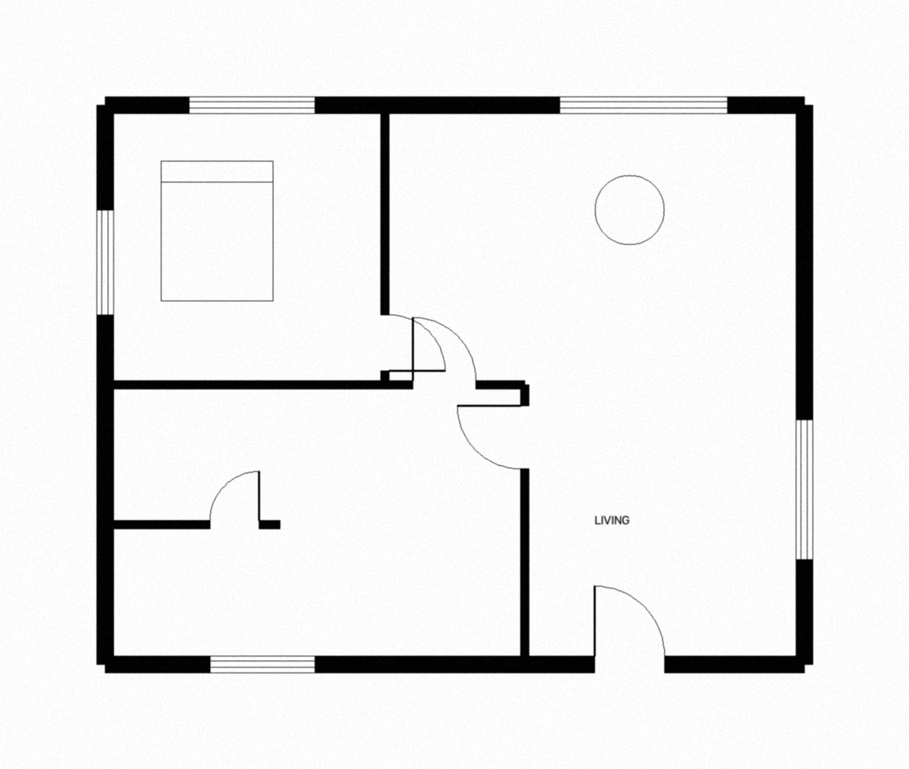
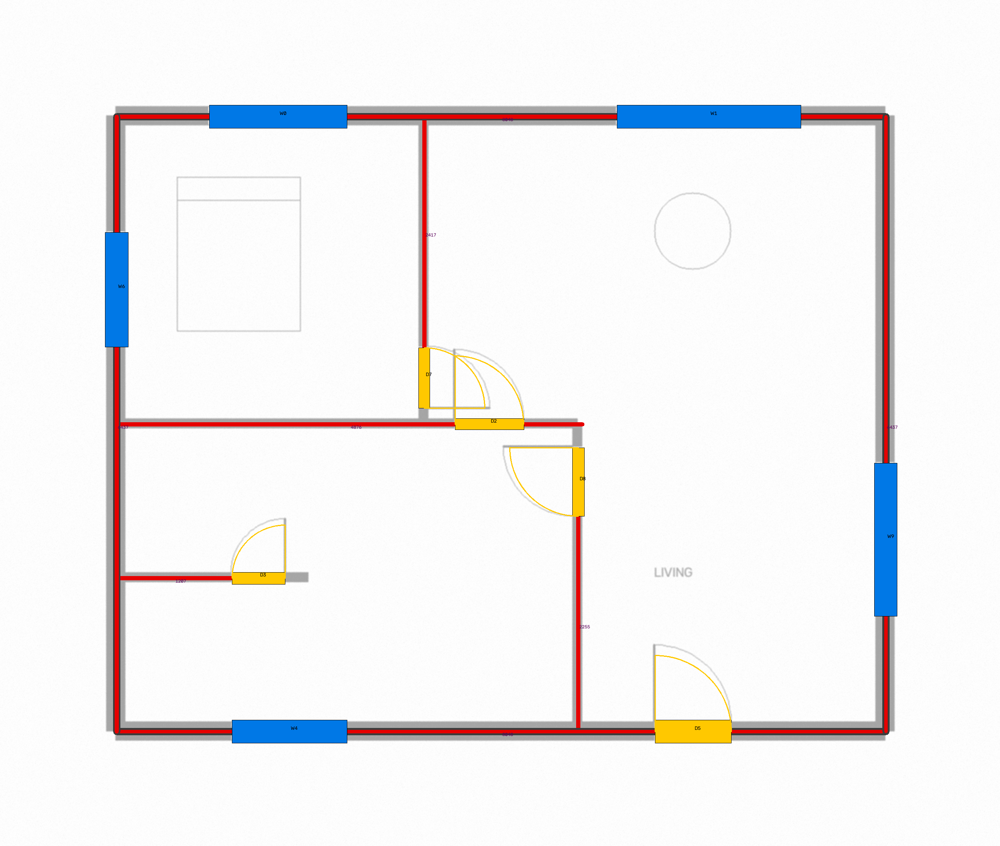
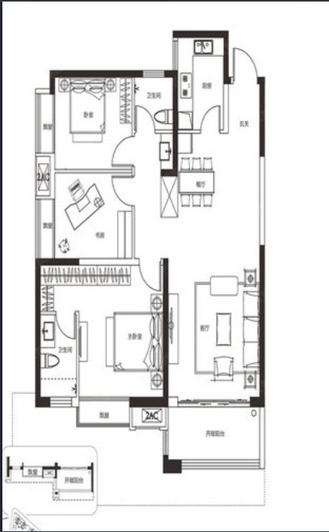
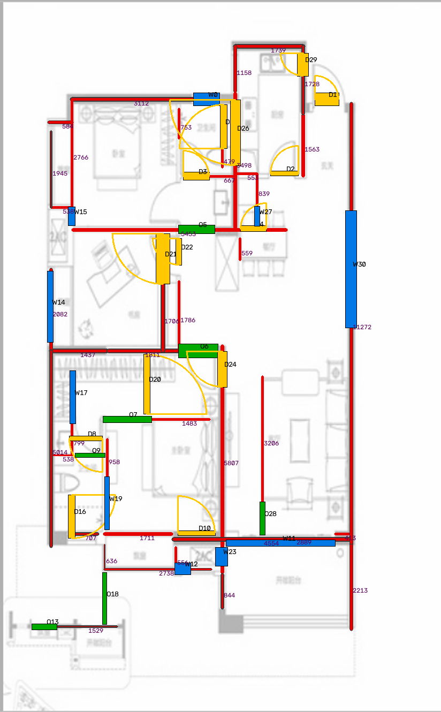
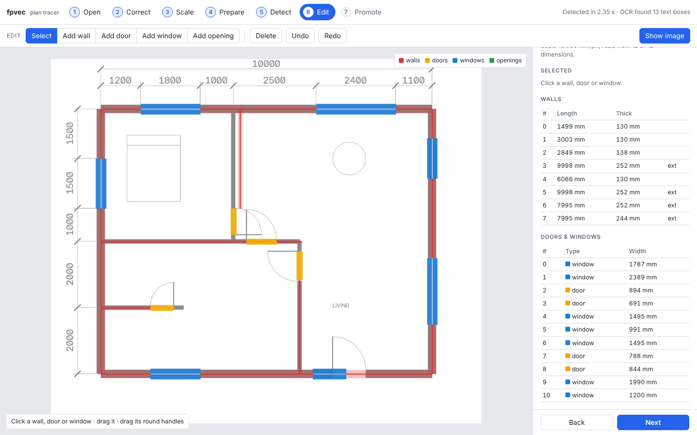
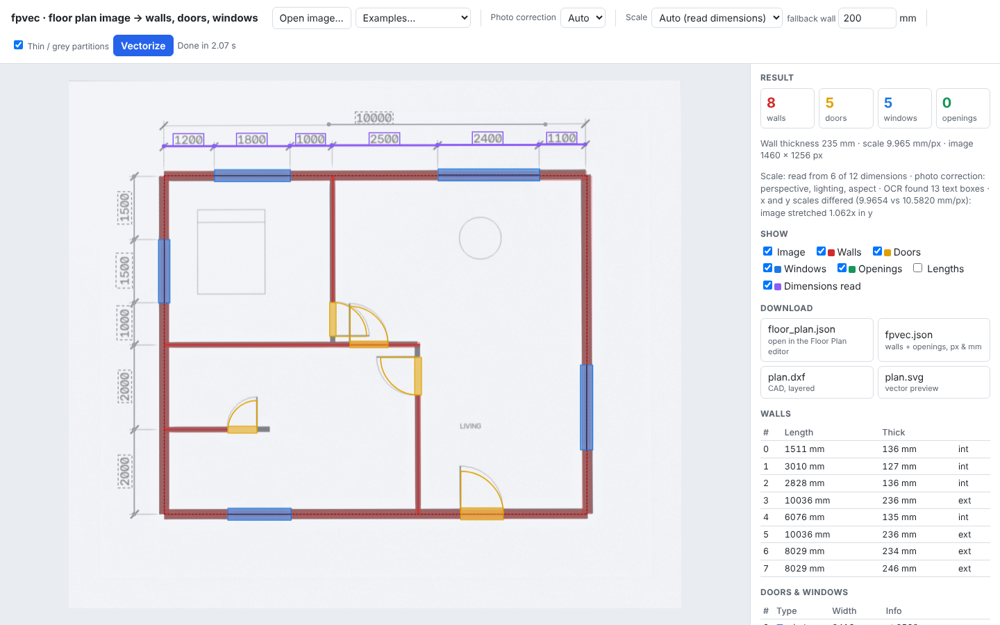

# fpvec: floor plan raster → vector

[](https://codespaces.new/GS-Manoj-Kumar/floor-plan-parser?quickstart=1)
&nbsp; **[Sample results](https://gs-manoj-kumar.github.io/floor-plan-parser/)** (15 coloured plans, clean and distorted)
· [samples/RESULTS.md](samples/RESULTS.md)

Turn a floor plan **image** into **vector walls, doors and windows** that a drawing/CAD tool can use directly.

* Walls come out as **centrelines with thickness**, flagged **exterior / interior**, with lengths in px and mm.
* Doors come out with **hinge point, width, swing side**, and the wall that hosts them.
* Windows and plain openings come out with **start / end / centre / width** and **offset along the host wall**.
* Export formats: **JSON**, **SVG**, **DXF** (layers WALLS / DOORS / WINDOWS / OPENINGS), a debug **overlay PNG**, and a
  **`floor_plan.json` that the Floor Plan editor (`floor_plan.html` / SketchUp dialog) opens directly**: walls, doors and
  windows as real editor objects, with the source image as a 50 % underlay.
* **PDF input** (any page). Vector PDFs give their dimension text straight from the text layer.
* **Automatic scale** from the plan's own dimension text: OCR (or the PDF text) reads the numbers, and each one is
  measured against its dimension line. Units: mm, cm, m or ft-in. Without dimensions, the room-area labels
  (`38.4 m2`, `220 sq ft`) are matched to the rooms the walls enclose.
* **Photo correction** (toggle): photos taken at an angle are de-warped (perspective), evened out (lighting) and
  straightened (rotation / shear). If the x and y scales still differ, the dimensions fix the aspect ratio.
* A **demo page** (upload → scale → vectorize → inspect → download), runnable in one click as a **GitHub Codespace**.

Pure Python + OpenCV + NumPy. No GPU and no model weights.

| Input | Output overlay |
|---|---|
|  |  |
|  |  |

Red = wall centrelines (dark outline = exterior), yellow = doors with swing arc, blue = windows, green = openings. Numbers are wall lengths in mm.

## Try it in a Codespace

**Code → Codespaces → Create codespace on main.** The container installs everything and starts the demo server.
Port 8000 opens in the browser (if it doesn't, open the **Ports** tab and click the globe icon next to 8000).



The demo page:

1. **Open image…** (or drag a file in, or pick one of the **Examples**).
2. **Photo correction**: *Auto* (default; only when the image looks like a photo of a sheet), *On* or *Off*.
   For a PDF, pick the **Page**.
3. **Scale.** Choose one:
   * *Auto (read dimensions)* (default): reads the dimension numbers. The ones it used are drawn in purple
     over the image, with the stretch each one measures. If none are found, it falls back to the wall thickness.
   * *Assume wall thickness*: e.g. 200 mm for the main wall.
   * *Two points + distance*: click two points, then type the real distance (`3600`, `3.6m` or `12'6"`).
   * *mm per pixel*.
4. **Vectorize.** Walls, doors (with swing) and windows are drawn over the image. Click one, or its table row, to highlight it.
5. **Download** `floor_plan.json` and open it with the editor's **Open** button. The image comes along as an underlay, so you can check and fix the trace there.

Locally, the same demo runs with:

```bash
pip install -e ".[api]"
fpvec-demo            # http://localhost:8000
```



*A phone photo of a printed plan (`examples/synth_photo.jpg`): sheet found, de-warped and straightened, and the scale read
from the dimensions. The image was 6 % stretched in y, which was detected and fixed. Exterior walls come out at 10 036 × 8 029 mm
against a true 10 000 × 8 000.*

## Sample set: 15 coloured plans, clean and distorted

`samples/` holds 15 generated coloured floor plans in five drawing styles: sales plan, wood floors, blue walls, grey
partitions and brown walls. They have textured floors, furniture, room labels with areas, and dimensions in mm or
ft-in (or none). Each plan is stored clean and distorted (a phone photo at an angle, or a crooked yellowed scan),
with exact ground truth. `python samples/run_samples.py` runs fpvec on all 30 and scores them (`fpvec/evaluate.py`):

| Set | Scale found automatically | Median size error | Walls found | Wall precision | Doors found | Windows found |
|---|---|---|---|---|---|---|
| Clean (15) | 15 / 15 (11 dimensions, 4 room areas) | 0.12 % | 100 % | 93 % | 88 % | 98 % |
| Distorted (15) | 14 / 15 (11 dimensions, 3 room areas) | 0.28 % | 96 % | 98 % | 75 % | 91 % |

Walls are scored as the share of true wall length matched within 150 mm, after fitting the overall size. Doors and
windows count when their centre is within 350 mm of a true one. Per-plan results with overlays are in
[samples/RESULTS.md](samples/RESULTS.md) and on the [results site](https://gs-manoj-kumar.github.io/floor-plan-parser/),
which `.github/workflows/pages.yml` rebuilds on every push to `main`.

**Weak spots:**
* Doors in photos and scans of the grey-partition style. After blur the light-grey partitions are barely darker than the floor.
* Wood-plank floors, which still produce some false wall pieces: wall precision is 67–83 % on 5 of the 30 images (wood and brown-wall styles).
* One distorted plan (09) whose partitions were partly missed, so its rooms did not close and the room-area scale could not be used.

## Photos, PDFs and automatic scale

```python
from fpvec import process
r = process("plan.pdf", page=0, auto_scale=True, photo="auto")   # or an image path / bytes / array
r.plan            # walls, doors, windows (px of r.image, mm filled in)
r.image           # the traced image (PDF page rendered, photo corrected)
r.scale_method    # "given" | "dimensions" | "room areas" | "wall" | "none"
r.scale.readings  # every dimension read: text, value, measured stretch, used or not
r.rectify.applied # e.g. ["perspective", "lighting", "rotate", "aspect"]
```

```bash
fpvec plan.pdf --page 2 -o out/          # scale read from the dimension text
fpvec photo.jpg --photo on -o out/       # photo correction forced on
fpvec plan.png --units ftin -o out/      # plain numbers are inches (12'-6" works anyway)
```

**Automatic scale** (`autoscale.py`):

1. **Text.** For a PDF, its text layer, which gives exact positions and needs no OCR. Otherwise
   [RapidOCR](https://github.com/RapidAI/RapidOCR) (Apache-2.0, ONNX models bundled, pip only, reads horizontal and
   vertical text).
2. **Parse** each number as a length: `3600` / `3600mm` → mm, `3.60` → m, `360cm`, `12'-6"`, `12'6"`, `150"`. Words and
   implausible values (under 150 mm or over 60 m) are ignored.
3. **Dimension line.** Find the long thin line parallel to the text, right next to it and running past both its ends.
4. **Ticks.** Find the marks crossing that line on each side of the text: 45° slashes, arrows, dots or extension lines.
   Text sits on one side only, so it is never mistaken for a tick. The stretch between the nearest tick on the left and
   on the right is what the number measures.
5. **Consensus.** Each reading gives a mm/px value, and the largest group agreeing within 2.5 % wins. Horizontal and
   vertical dimensions are also solved on their own. If they disagree (a photo, or a scan stretched by the scanner),
   the image is stretched so its pixels are square.

**Room areas** (no dimensions): area labels (`38.4 m2`, `38.4m²`, `12 sqm`, `220 sq ft`) are placed in the rooms
that the detected walls enclose (doorways closed), measured to the wall centrelines. Each label gives
`mm/px = √(area mm² / area px²)`, and the rooms vote. On the sample set this is within 1 % of the true scale.

**PDF** (`inputs.py`): rendered with [pypdfium2](https://github.com/pypdfium2-team/pypdfium2) (PDFium; Apache-2.0 / BSD) at
`dpi` (default 200 in the demo and CLI). Coordinates refer to the rendered page, which is also embedded as the editor underlay.

**Photo correction** (`rectify.py`, OpenCV only):

1. **Sheet.** The paper is the large bright region. Its outline is reduced to 4 corners and the perspective is removed.
2. **Lighting.** The image is divided by a heavily smoothed copy of itself, so shadows and light gradients vanish.
3. **Straighten.** The two dominant line directions (Hough) are rotated and sheared back to exactly horizontal and vertical.
4. **Aspect.** A perspective photo does not fully fix the sheet's aspect ratio. When the plan has dimensions, the
   per-axis scales fix it (step 5 above).

*Auto* applies the correction only when the image looks like a photo: a sheet edge is visible, or the paper is strongly
uneven. Clean scans and screenshots pass through untouched.

| Test (`tests/test_autoscale.py`) | Result |
|---|---|
| Dimensions in mm, OCR | scale exact (12 / 12 dimensions agree) |
| Dimensions in ft-in, OCR | within 0.1 % (labels are rounded to the inch) |
| PDF with a text layer / scanned PDF (OCR), 72–300 dpi | scale exact |
| Photos: tilt up to 0.18, rotation up to 25°, uneven light, JPEG | exterior walls within 1.5 % (typically 0.3–0.5 %), 5/5 windows, ≥ 4/5 doors |

## Install

```bash
pip install -r requirements.txt        # numpy + opencv-python-headless
pip install -e ".[all]"                # + PDF (pypdfium2), OCR (rapidocr-onnxruntime), demo server
```

## Use

### Command line

```bash
# you know the scale (mm per image pixel), e.g. from your app's "scale" step
fpvec plan.png --mm-per-px 12.5 -o out/

# or: two points on the image and the real distance between them (mm)
fpvec plan.png --ref 120 340 980 340 8400 -o out/

# or: no scale, just assume the main wall is 200 mm thick
fpvec plan.png --wall-mm 200 -o out/
```

This writes `out/plan.json`, `plan.svg`, `plan.dxf`, `plan_overlay.png` and **`plan_floor_plan.json`** (the editor document).

### Python

```python
from fpvec import vectorize, mm_per_px_from_reference, to_json, to_dxf

scale = mm_per_px_from_reference((120, 340), (980, 340), 8400)   # user's scale step
plan = vectorize("plan.png", mm_per_px=scale)

for w in plan.walls:
    print(w.id, w.start, w.end, w.thickness, w.exterior)
for o in plan.openings:
    print(o.kind, o.start, o.end, o.width, o.hinge, o.swing_side, o.host_wall_ids)

to_json(plan, "plan.json")
to_dxf(plan, "plan.dxf")

from fpvec import save_floorplan_doc            # Floor Plan editor document
save_floorplan_doc(plan, "plan_floor_plan.json", image_path="plan.png")
```

### HTTP (for a web/JS front end)

```bash
pip install -e ".[api]"
fpvec-demo --port 8000
curl -F file=@plan.png -F mm_per_px=12.5 http://localhost:8000/api/vectorize
```

`/api/vectorize` takes `file` plus one of `mm_per_px` / `wall_mm`, and optionally `wall_px` and `thin_walls=0|1`.
It returns `{plan, floorplan, dxf, svg, seconds}`: `floorplan` is the editor document, ready for the
editor's `loadDoc(fixDoc(...))`.

## Floor Plan editor document

`to_floorplan_doc(plan)` / `--formats floorplan` writes the editor's own format (`app: "floorplan"`, mm, **y up**):

| fpvec | editor entity |
|---|---|
| wall (centreline, thickness) | `wall {a, b, bg: 0, thk, h: 3048, just: "C", top: "next"}` on layer `LW` |
| door | `opening {wall, kind: "door", s0, w, h: 2133.6, sill: 0, style: "single"\|"double", hinge: "L"\|"R", side: ±1}` |
| window | `opening {kind: "window", style: "std", h: 1219.2, sill: 914.4}` |
| plain opening | `opening {kind: "cut", style: "none"}` |
| source image | `image {src, p: {0,0}, w, h, op: 0.5}` on layer `LI`, so the trace sits exactly on it |

* `s0` is measured along the wall's centreline from `a`.
* `hinge`/`side` follow the editor's convention: local x along the wall from `s0`, swing towards `vperp(u)` when `side = 1`.
* An opening that sits just past a wall's end (a door next to a corner) makes that wall run on through it.
* An opening with no wall around it gets its own short wall.

Heights and sills are the editor defaults. Change them in the editor afterwards, or pass `wall_h=` to `to_floorplan_doc`.
The export was checked by loading it in `floor_plan.html` (headless Chromium): every wall builds geometry, every
opening resolves on its wall, and there are no errors.

## Output (JSON)

All coordinates are in **original image pixels** (origin top-left, y down). The `_mm` fields are filled in when a scale is given.

```jsonc
{
  "image_size_px": [1240, 1754],
  "mm_per_px": 12.5,
  "wall_thickness_px": 19.2,          // detected main wall thickness
  "walls": [{
    "id": 0, "orientation": "h", "exterior": true,
    "start_px": [102.0, 88.5], "end_px": [1130.0, 88.5],
    "length_px": 1028.0, "thickness_px": 19.6,
    "start_mm": [1275.0, 1106.3], "end_mm": [14125.0, 1106.3],
    "length_mm": 12850.0, "thickness_mm": 245.0
  }],
  "openings": [{
    "id": 3, "type": "door",             // "door" | "window" | "opening"
    "orientation": "h", "host_wall_ids": [0],
    "start_px": [...], "end_px": [...], "center_px": [...], "width_px": 72.0,
    "width_mm": 900.0, "offset_on_host_mm": 3100.0,
    "hinge_px": [...], "swing_side": "down", "double": false,
    "confidence": 0.93
  }]
}
```

Walls are **continuous runs**: a wall with a door in it is one wall, and the door references it through `host_wall_ids` and `offset_on_host_*`. Set `Params(merge_across_openings=False)` to get the wall pieces between openings instead.

## How it works

```
image ─► normalise (long side 1600 px) ─► ink mask ─► stroke widths ─► walls ─► openings ─► doors ─► tidy ─► export
```

1. **Stroke widths** (`preprocess.py`). The image is opened with long 1-px kernels so only long straight strokes remain. Their thickness is histogrammed (weighted by ink area): thin drawing lines form one peak, walls the dominant thicker peak. This gives the **wall thickness T** automatically, so every other threshold is a multiple of T and the method is resolution-independent.
2. **Solid walls** (`walls.py`). A square morphological opening (≈0.4 T) deletes everything thinner than a wall: text, furniture, arcs and glazing lines. The remaining mask is split into horizontal and vertical bars. Each bar becomes a centreline segment with measured thickness. Furniture blobs glued to walls are rejected by *relative* row coverage.
3. **Grey & thin-line walls** (`thinlines.py`, `pipeline.py`). Sales plans often draw only structural walls black, and partitions
   in **mid/light grey**: two grey lines, often with a light-grey fill. Those are invisible to a global ink threshold, so:
   * thin lines are found by **local contrast** (a black-hat filter: darker than their surroundings, whatever their grey level);
   * **grey bands** of wall width (grey outline plus fill) are found with a wider black-hat followed by an opening. Because furniture
     outlines look the same, a band only counts as a wall if it touches the wall network at one end and, at the other end, touches
     it too or faces a wall across a door-sized gap;
   * a thin double line that continues a thicker solid wall on the same axis is **glazing** (a window), not a partition;
   * of several parallel candidates side by side (a bookshelf against a partition), only one is kept.

   Classic line pairs are handled as before: Many plans draw partitions as two thin parallel lines and windows as 3–4 lines. Pairs of long parallel thin lines about one wall thickness apart are found. A pair with empty space between is a **hollow wall**, and one with line(s) between is a **window band**. Hollow walls are kept only if they connect to the wall network, which removes beds and wardrobes.
4. **Openings** (`openings.py`). From each wall end, walk along the wall axis until wall ink is hit again. Each gap is classified by its content: parallel glazing lines → **window**, nothing → **opening**. Window glazing is often light grey, so a lenient threshold is used for this test.
5. **Doors** (`doors.py`). A door must be anchored: either its arc sits in a detected wall gap, or its closed leaf lies on a wall line (a wall on the door's axis ends at the hinge or latch, or there is wall on both sides). This removes beds, chairs and toilets. Door swing arcs are found two ways: circle fits of curved strokes, and a search from every wall end over radius × swing direction. Candidates are refined by local search. Each is scored by arc coverage, a blank swept area (rejects toilets and chairs), and wall ink at both jambs. An arc labels the gap it sits in as a door, or creates a door when no gap was found (e.g. an entrance between two wall stubs). Result: hinge, width (radius), swing side.
6. **Tidy** (`pipeline.py`). Collinear pieces are merged, wall ends snap to perpendicular centrelines (clean L/T junctions), and small detached clusters outside the main plan (key plans, legends) are dropped. Walls are flagged exterior by testing both sides against the filled building footprint.

## Accuracy

`fpvec/synth.py` renders plans with known ground truth (solid or hollow interior walls, swing doors, 4-line windows, furniture, text, optional blur + noise). From `pytest tests/`:

| Plan | Windows | Doors | Width error |
|---|---|---|---|
| Solid walls (clean, and with blur + noise) | 5 / 5 | 5 / 5 | < 15 mm |
| Hollow (double-line) interior walls | 5 / 5 (+1 false 0.5 m window at a junction) | 4 / 5 | < 150 mm |
| Grey partitions (grey outline + light fill) | 5 / 5 (+3 false short windows) | 4 / 5 | all 4 partitions found; 120 mm walls read as 138 mm |
| Exterior wall length | 4 / 4 | | < 5 mm; thickness 240 mm ± 10 |

On the bundled `examples/sample_plan.png`, v0.2 finds the grey partitions that v0.1 missed: bedroom/bath, kitchen,
study, the master bath and wardrobe, and the inner face of the bay-window wall. It finds 41 walls, against 25 in v0.1, plus
most of the doors. Some furniture (bedside tables, the bed) still comes through as short walls, windows or extra doors.
Black-and-white drawings use a stricter thin-line threshold than colour plans and photos, which keeps the
anti-aliasing of small screenshots like this one from turning into false windows. That image is a 412 px wide screenshot (≈27 mm per pixel), where a door arc is only ~25 px across. Expect better results from source images **≥ 1500 px** on the long side.

## Limitations and tuning

* Walls are assumed **axis-aligned** (horizontal/vertical), which covers almost all residential plans. Diagonal and curved walls are not extracted yet.
* **Sliding doors** are drawn like windows and come out as `window`. **Bay windows** (飘窗) come out as a window plus short walls.
* Auto scale needs printed dimension numbers with dimension lines. Plans with only room areas or a scale bar fall
  back to the wall-thickness assumption (scale bars are not read yet). Very small images may give OCR nothing to read:
  the 412 px sample does, for example.
* Photo correction needs the sheet's corners in view for the perspective step. Without them it still evens out the
  lighting and straightens the drawing. Strong lens distortion (wide-angle, close up) is not corrected.
* Heavily stylised marketing plans (coloured floors, 3D furniture, photos) may need `Params(ink_threshold=...)`, or a learned wall mask (see `docs/reference_repos.md`).
* Main knobs (`fpvec.Params`): `wall_thickness_px` (override the estimate), `detect_thin_walls`, `min_opening_mm` / `max_opening_mm`, `door_score`, `merge_across_openings`.

Debug: `vectorize(img, debug=d)` fills `d` with the intermediate masks (`ink`, `solid`, `thin`, `barrier`, `footprint`) and the working scale.

## Layout

```
fpvec/
  preprocess.py  load, binarise, stroke-width estimation
  walls.py       wall mask, bar → segment extraction, merging, junction snapping
  thinlines.py   hollow walls and window bands from parallel thin lines
  openings.py    gap search along walls + window/opening classification
  doors.py       swing-arc door detection (hinge, width, swing)
  pipeline.py    vectorize() + Params
  models.py      Wall / Opening / FloorPlan + JSON dict
  export.py      JSON, SVG, DXF, overlay PNG
  scale.py       mm-per-px from a reference distance or wall thickness
  floorplan_doc.py  export to the Floor Plan editor document (floor_plan.json)
  process.py     one call: load (image / PDF) -> photo correction -> auto scale -> vectorize
  inputs.py      image / PDF loading (pypdfium2), PDF text layer
  autoscale.py   dimension text -> scale (OCR, parsing, dimension lines, ticks, consensus)
  rectify.py     photo correction: sheet perspective, lighting, rotation / shear, aspect
  synth_color.py coloured plan generator (5 styles) with ground truth
  evaluate.py    scores a result against ground truth (mm, size-fitted shape scores)
samples/         15 plans x (clean + distorted), outputs, RESULTS.md, run_samples.py
scripts/build_site.py   static results site for GitHub Pages
  web/index.html    demo page (served by api.py)
  synth.py       synthetic plans with ground truth
  cli.py         command line
  api.py         FastAPI: demo page + /api/vectorize (`fpvec-demo`)
.devcontainer/   Codespace: installs, starts the demo on port 8000
docs/reference_repos.md   review of the six reference repos
```
